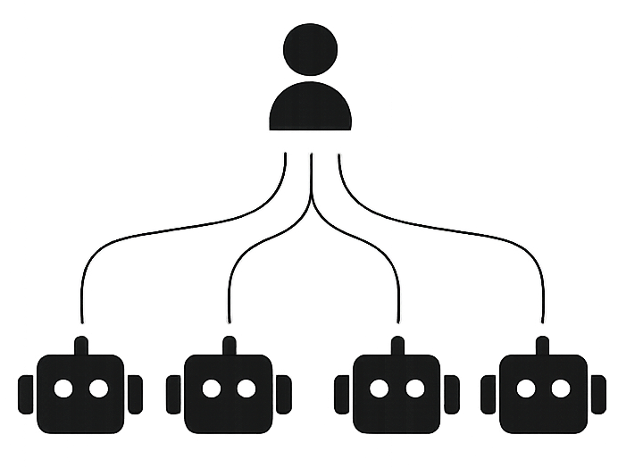

> 部署和升级说明：[karma-team 迁移指南](./docs/renaming.md)。请配置自己的服务地址；发布新名称的安装包后，文档中的下载链接才可使用。

<p align="center">
  <picture>
    <source media="(prefers-color-scheme: dark)" srcset="./karma-team-symbol-dark.svg" />
    <source media="(prefers-color-scheme: light)" srcset="./karma-team-symbol-light.svg" />
    
  </picture>
</p>

<p align="center"><b>karma-team —— AI 智能体编排平台</b></p>

<p align="center">
    <a href="https://airepublic.com/"><b>官网</b></a> •
    <a href="https://airepublic.com/docs"><b>文档</b></a> •
    <a href="https://airepublic.com/"><b>社区</b></a> •
    <a href="https://x.com/ai_republic"><b>X</b></a>
</p>

<p align="center">
    <a href="./README.md"><b>English</b></a> •
    <b>简体中文</b> •
    <a href="./README.ja.md"><b>日本語</b></a> •
    <a href="./README.pt-BR.md"><b>Português (BR)</b></a> •
    <a href="./README.es.md"><b>Español</b></a> •
    <a href="./README.ko.md"><b>한국어</b></a>
</p>

karma-team 是一个开源的 AI 智能体编排平台，专为 **As Coding（异步氛围编程）** 打造——在这种工作流中，你只需定义需要构建的内容，编码智能体便会在后台完成具体实现。无需再盯着智能体运行、看着终端不断滚动，karma-team 让你专注于真正重要的工作：规划任务、审阅结果、交付产品。

> karma-team 每天都在不断进化。你的建议、想法和反馈的 bug 对我们帮助极大。欢迎随时发起 [GitHub 讨论](https://github.com/xerecter/karma-team/discussions) 或 [提交 issue](https://github.com/xerecter/karma-team/issues)。我们会阅读每一条反馈，并回复其中的绝大多数。

## 🌟 架构

karma-team 由三大核心组件构成：

<p align="center">
  <picture>
    <source media="(prefers-color-scheme: dark)" srcset="./images/karma_team_diagram_white.png" />
    <source media="(prefers-color-scheme: light)" srcset="./images/karma_team_diagram_black.png" />
    
  </picture>
</p>

### karma-team 平台

基于 Web 的编排中枢，用于管理项目、定义任务、监控智能体进度。在这里创建工作项，将它们组织成周期（cycle）和模块（module），审阅智能体的输出，并跟踪分析数据——一切都在同一个仪表盘中完成。你把时间花在这里，而不是盯着终端。

### karma-team CLI 与 Runner 守护进程

运行在你的开发机器上的本地命令行工具和后台守护进程。CLI 连接到 karma-team 平台，领取分配的任务，将其派发给你配置的 AI 智能体，并把结果回报。Runner 守护进程持续保持这一循环运转，因此你无需手动触发每个任务。

### AI 智能体（由用户提供）

karma-team 与智能体无关——你可以使用自己的编码智能体。目前 Runner 已对 **Claude Code** 和 **Codex** 提供一流支持；派发层的设计使得在不改变编排模型的前提下即可接入更多智能体。你只需配置 Runner 调用哪个智能体，其余的交给 karma-team 处理。

## 🚀 安装

### 1. karma-team 平台（自托管）

#### 环境要求

- 已安装并正在运行的 Docker Engine
- Node.js 22+ 版本（[LTS 版本](https://nodejs.org/en/about/previous-releases)）
- Python 3.12+ 版本
- Postgres v15+ 版本
- Valkey v7+（或 Redis 7+，可直接替换兼容）
- **内存**：建议至少 **12 GB RAM**
  > 在仅有 8 GB RAM 的系统上运行本项目可能导致安装失败或内存崩溃（尤其是在 Docker 容器构建/启动或安装依赖期间）。如有可能，请使用 GitHub Codespaces 等云端环境，或升级本地内存。

#### 配置步骤

1. 克隆仓库

```bash
git clone https://github.com/xerecter/karma-team.git [folder-name]
cd [folder-name]
chmod +x setup.sh
```

2. 运行 setup.sh

```bash
./setup.sh
```

`setup.sh` 会把每个 `.env.example` 复制为对应的 `.env`（包括仓库根目录以及 `apps/web`、`apps/api`、`apps/space`、`apps/admin`、`apps/live`），生成唯一的 Django `SECRET_KEY` 并追加到 `apps/api/.env`，然后运行 `pnpm install`。对于默认的本地回环开发配置，你无需手动编辑任何 `.env` 文件——`.env.example` 中的默认值（localhost URL、`karma-team` 数据库凭据、本地 MinIO 端点等）开箱即用。只有在你需要绑定到非默认主机/端口或接入外部服务时，才需要修改它们。

3. 启动容器

```bash
docker compose -f docker-compose-local.yml up
```

4. 启动 Web 应用：

```bash
pnpm dev
```

5. 在浏览器中打开 http://localhost:3001/god-mode/ ，将自己注册为实例管理员
6. 在浏览器中打开 http://localhost:3000 ，使用相同的凭据登录

#### 生产环境部署

对于真正的自托管部署（而非本地开发），请根据你希望自行管理的程度选择对应方案：

- **[All-in-One Docker 镜像](./deployments/aio/community/README.md)** —— 单个容器打包了所有 karma-team 服务，内部由 `supervisord` 管理。最简单的方式：一条 `docker run` 命令。适合演示、homelab 环境、评估以及小型团队。仍需外部的 Postgres / Redis / RabbitMQ / 兼容 S3 的存储。
- **[Docker Compose / Swarm 自托管](./deployments/cli/community/README.md)** —— 完整的微服务栈（6 个服务容器 + 数据库 + 队列 + 存储）。配置更多，但能为每个服务提供独立扩缩容和滚动更新。除评估场景外，推荐使用此方案。
- **Kubernetes / Helm** —— Helm chart 的发布已在计划中，但尚未推出；详见 [`deployments/kubernetes/community/README.md`](./deployments/kubernetes/community/README.md)。

### 2. karma-team CLI 与 Runner 守护进程

在任何你希望智能体领取并执行任务的机器上安装 CLI。目前支持的平台：

- **macOS** —— Apple Silicon（arm64）
- **macOS** —— Intel（x86_64）
- **Linux** —— arm64 和 x86_64
- **Windows** —— x86_64

在 macOS 和 Linux 上，在开发机器的终端中运行以下命令：

```bash
curl --proto '=https' --tlsv1.2 -LsSf \
  https://github.com/xerecter/karma-team/releases/latest/download/karma-team-installer.sh | sh
```

在 Windows 上，下载并运行 MSI 安装程序：

<https://github.com/xerecter/karma-team/releases/latest/download/karma-team-x86_64-pc-windows-msvc.msi>

如需固定到特定版本（或安装预发布版本），将 `latest` 替换为对应标签即可，例如 `.../releases/download/karma-team-v0.1.4/karma-team-installer.sh`。预发布版本不会包含在 `/latest/` 中，因此上面的一行命令始终提供最近的稳定版本。完整的版本固定方法——封装脚本、裸安装程序、Windows 各变体——详见 [`runner/README.md`](./runner/README.md#installing-a-specific-version-pinning--prereleases)。

随后对该机器进行认证并绑定账号。标准流程只需一条命令：

```bash
# 1. 基于浏览器的设备码登录（类似 `gh auth login` / `stripe login`）。
#    会在 ~/.config/karma-team/config.toml 中存储 CLI 令牌。
karma-team auth login --url https://your-karma-team-instance.com

```

`karma-team auth login` 会持久化账号、workspace 与开发机器绑定，并在本地尚无
runner 时照常安装和启动服务。Daemon 会立即读取该 workspace 的云端 project，
为每个尚未绑定的 project 幂等创建一个独立 runner；之后新增或删除 project
也会在后台自动对账。只有在需要额外 runner 或非默认 pod 时，才需要手动执行
`karma-team runner add --project <other-project-id>`。

Runner 守护进程在后台运行，轮询分配的任务，将其派发给你的 AI 智能体，并把结果回报给平台。

常用命令：

| 命令                | 说明                                                       |
| ------------------- | ---------------------------------------------------------- |
| `karma-team status` | 打印服务和守护进程状态                                     |
| `karma-team tui`    | 打开交互式终端 UI 以监控守护进程                           |
| `karma-team doctor` | 运行预检（智能体是否已安装、git 是否已配置、平台是否可达） |
| `karma-team stop`   | 停止守护进程                                               |

运行 `karma-team --help` 查看所有可用命令。

### 3. AI 智能体（由用户提供）

karma-team 不附带 AI 智能体——你需要自备。请确保你所选的智能体 CLI 已安装，并在运行 karma-team CLI 的机器上可访问。Runner 目前开箱支持两类智能体：

- **Claude Code** —— 安装 [`claude`](https://docs.anthropic.com/en/docs/claude-code)，并确保 `claude --version` 可正常运行。
- **Codex** —— 安装 [`codex`](https://github.com/openai/codex)，并确保 `codex --version` 可正常运行。

在你正式上线之前，`karma-team doctor` 会验证所配置的智能体是否在 `PATH` 中，以及云端是否可达。

### 4. 面向编码智能体的 karma-team skill（可选）

[`karma-team-skill`](https://github.com/xerecter/karma-team-skill) 将一个可移植的智能体 skill 打包在一起，使 Claude Code 或 Codex 能够通过 `karma-team` CLI 直接在编码会话中创建、列出、移动和查看 karma-team issue。

```bash
npx @airepublic/karma-team-skill-installer           # 安装到 Claude Code、Codex 或两者
```

安装程序会提示选择目标（默认：全部），并按需从 GitHub 获取 skill——无需克隆。传入 `--all`、`--claude-code` 或 `--codex` 可跳过提示。

Codex 用户也可以在 Codex 会话内通过内置的 `$skill-installer` 进行安装。关于环境变量覆盖（`CLAUDE_HOME` / `CODEX_HOME`）、基于克隆的安装方式以及其他替代方案，详见 [karma-team-skill README](https://github.com/xerecter/karma-team-skill#readme)。

## ⚙️ 技术栈

[](https://reactrouter.com/)
[](https://www.djangoproject.com/)
[](https://nodejs.org/en)

## 📝 文档

浏览 [karma-team 文档](https://airepublic.com/docs) 以了解功能、配置和使用方法。

## ❤️ 社区

加入 [GitHub Discussions](https://github.com/xerecter/karma-team/discussions) 的讨论，在 X 上关注 [@ai_republic](https://x.com/ai_republic)，或访问 [airepublic.com](https://airepublic.com/) 获取最新动态。我们在所有社区渠道中均遵循 [行为准则](./CODE_OF_CONDUCT.md)。

欢迎提问、反馈 bug、参与讨论、分享想法、请求新功能，或展示你的项目。我们非常期待你的声音！

## 🛡️ 安全

如果你在 karma-team 中发现了安全漏洞，请负责任地报告，而不要公开提交 issue。更多信息详见 [SECURITY.md](./SECURITY.md)。

如需披露任何安全问题，请发送邮件至 [privacy_security@airepublic.com](mailto:privacy_security@airepublic.com)。

## 🤝 贡献

你可以通过多种方式为 karma-team 做出贡献：

- 报告 [bug](https://github.com/xerecter/karma-team/issues/new) 或提交功能请求。
- 审阅文档并提交 pull request 加以改进——无论是修正错别字还是补充新内容。
- 为 [热门功能请求](https://github.com/xerecter/karma-team/issues) 点赞，表达你的支持。

有关提交 pull request 流程的详情，请阅读 [CONTRIBUTING.md](./CONTRIBUTING.md)。

### 没有你们，我们无法走到今天。

<a href="https://github.com/xerecter/karma-team/graphs/contributors">
  我们的社区贡献者
</a>

## 致谢

karma-team 构建于 [Plane](https://github.com/makeplane/plane) 之上，这是一个开源的项目管理工具。我们衷心感谢 Plane 团队及其贡献者，是他们奠定的基础让 karma-team 成为可能。

## 许可证

本项目基于 [GNU Affero General Public License v3.0](./LICENSE.txt) 授权。
